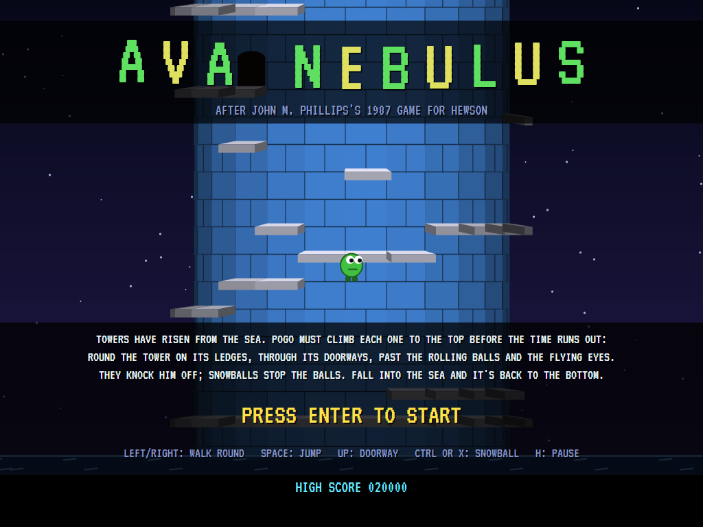
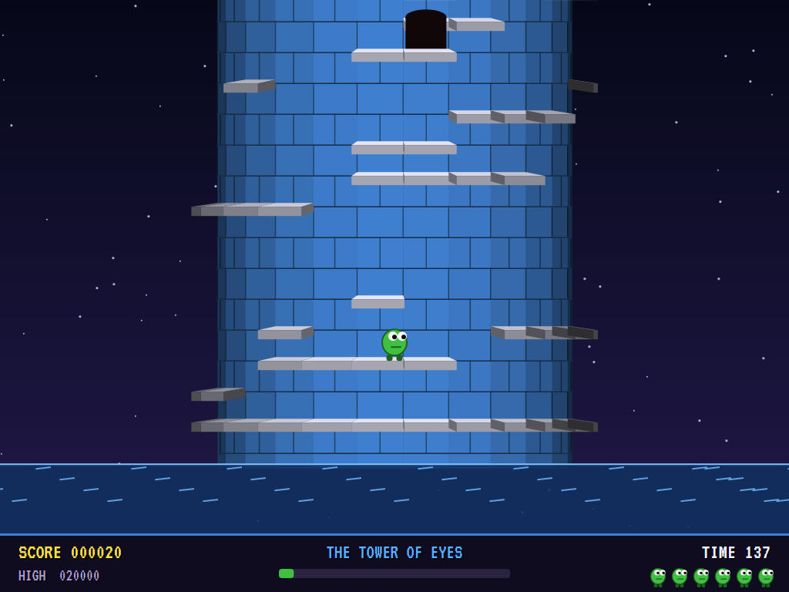
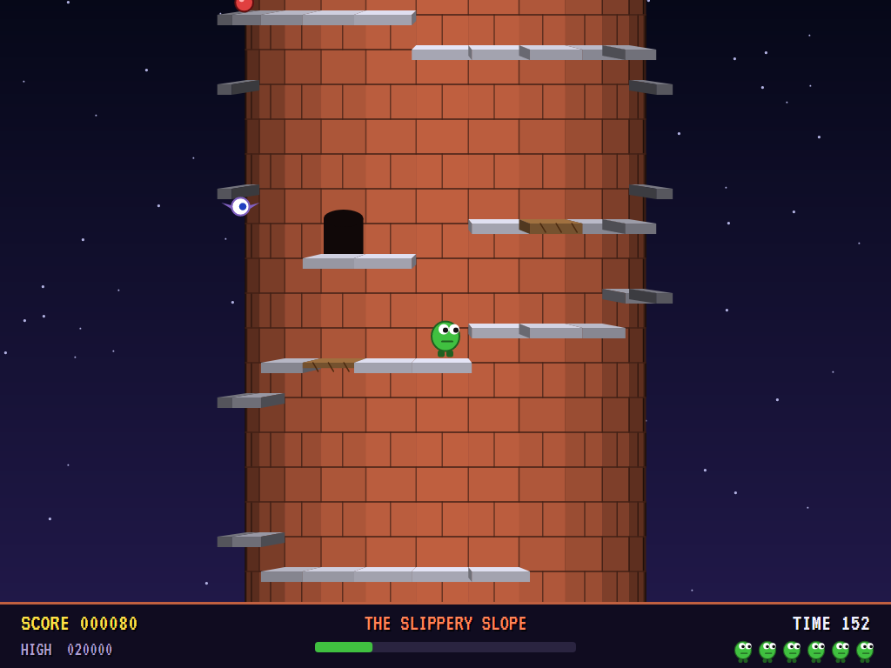
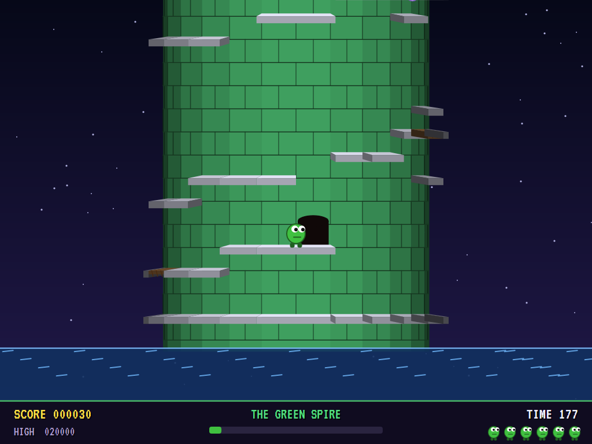
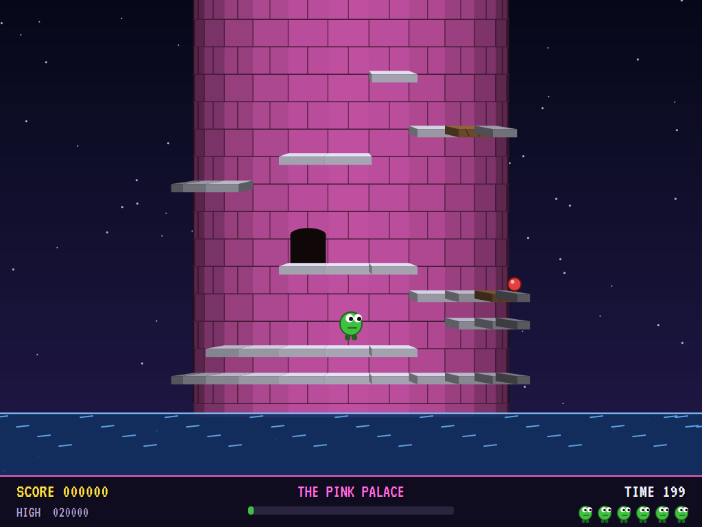
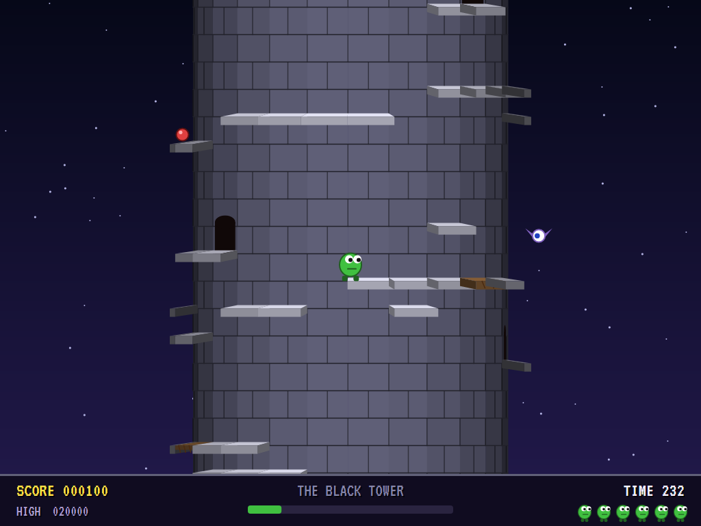
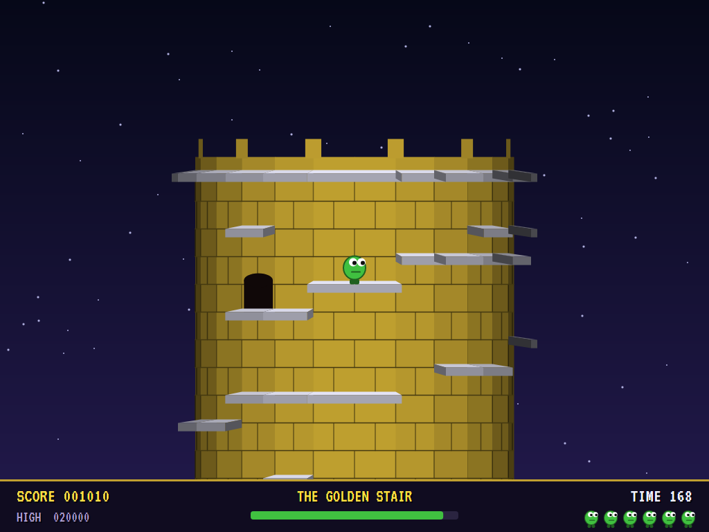
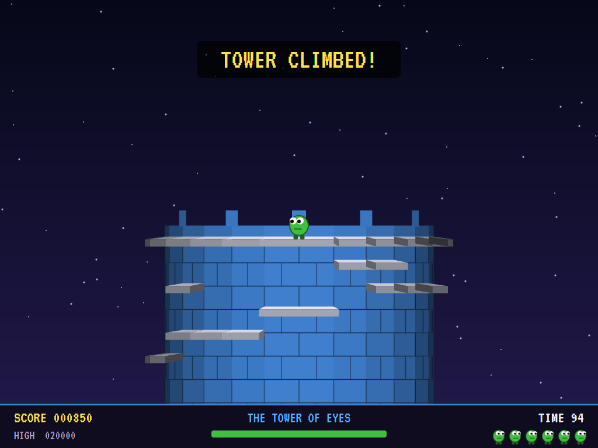
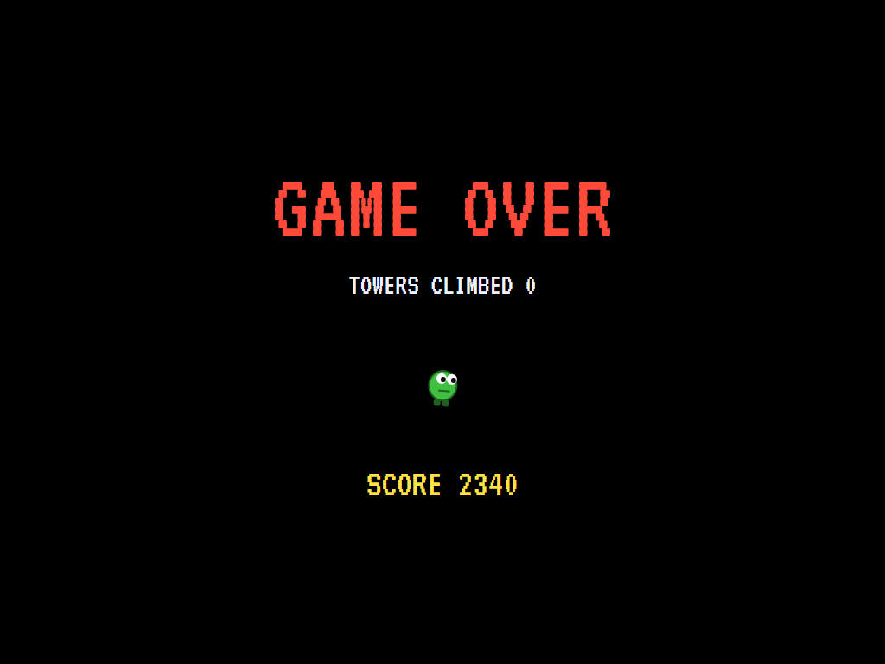
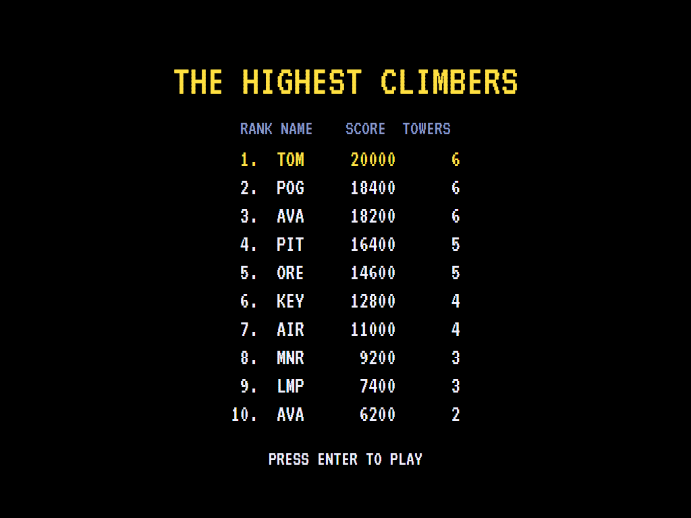

# AVA Nebulus

[](https://github.com/Harlock123/AVANebulus/actions/workflows/build.yml)

A platform game round the outside of a turning tower, in the style of John M. Phillips's 1987 game **Nebulus**
for Hewson. It's built with .NET 10 and Avalonia UI. Towers have risen from the sea. Pogo must climb each one to
the top before the time runs out. He goes round the tower on its ledges, through its doorways and past the
rolling balls and flying eyes that knock him off.

## Features

- **The tower turns, not Pogo.** He stays front and centre as the tower turns under him. Its bricks are shaded
  by their angle to you, and the ledges, doorways, balls and eyes go round with it. The stars drift more slowly
  behind it, and the sea laps at its foot.
- **Climbing:** walk round the tower, and jump (a fixed arc) up onto the next ledge, one row up. Two rows is out
  of reach. Step off a ledge and he drops to whatever is below. Some ledges crumble under him.
- **Doorways** go right through the tower: in at one side, out at the other.
- **Balls** roll to and fro along the ledges and **eyes** fly round the tower. Either one knocks Pogo off, back
  down to wherever he lands. A snowball stops a ball; the eyes have to be dodged.
- **The sea:** fall in and it's a life lost, and back to the foot of the tower. Run out of time and it's the
  tower again from the start.
- **Six towers,** each taller, with more on it and more time to climb it. Each is built from its own seed: a
  spiral of ledges round and up, doorways through, and odd ledges off the way. It's kept only if trying every
  walk, jump and doorway in the game's own physics shows the top can be reached.
- **The score:** points for every row higher, for every ball, and for the time to spare at the top.
- **The attract mode** shows the computer Pogo at work. It knows every ledge it can stand on and where every walk,
  jump and doorway takes it, and plans the quickest climb. Before each move it plays the move out on a copy of
  the tower, balls and eyes and all, and waits for its moment. It throws a snowball at any ball in its way.

## Screenshots

| The title | At the foot | A jump |
|:---------:|:-----------:|:------:|
|  |  |  |
| The first tower, turning. | The sea, and the way up. | Up to the next ledge. |

| A doorway | A ball | An eye |
|:---------:|:------:|:------:|
|  |  |  |
| Through to the far side. | Rolling along a ledge. | Flying round the tower. |

| Near the top | Climbed | Game over |
|:------------:|:-------:|:---------:|
|  |  |  |
| The battlements in sight. | The time left counted in. | |



The screenshots are made by the tests, which play the game in a real (headless) window; see
[Tests](#tests).

## Download and run

Ready-to-run builds for Windows, macOS and Linux, on both Intel/AMD and ARM, are on the
[Releases page](https://github.com/Harlock123/AVANebulus/releases/tag/latest). **Latest build** is
rebuilt on every push to `main`. Each download is one self-contained executable: no .NET install is
needed.

| Platform | Archive |
|---|---|
| Windows | `AVANebulus-win-x64.zip`, `AVANebulus-win-x86.zip`, `AVANebulus-win-arm64.zip` |
| macOS | `AVANebulus-osx-arm64.tar.gz` (Apple silicon), `AVANebulus-osx-x64.tar.gz` (Intel) |
| Linux | `AVANebulus-linux-x64.tar.gz`, `AVANebulus-linux-arm64.tar.gz`, `AVANebulus-linux-arm.tar.gz` |

```bash
tar -xzf AVANebulus-linux-x64.tar.gz     # or linux-arm64, linux-arm, osx-arm64, osx-x64
./AVANebulus
```

On Windows, unzip and run `AVANebulus.exe`. On macOS, if Gatekeeper refuses to open it, run
`xattr -d com.apple.quarantine AVANebulus` once. Run with `--no-audio` for silence.

**Sound** comes through OpenAL Soft, built in for every platform. In a virtual machine the game
detects it and uses a larger audio buffer, so the sound doesn't break up.

**Gamepads** use SDL2, which is bundled for Windows, macOS and Intel/AMD Linux. ARM Linux builds need it
installed; without it the keyboard still works:

```bash
sudo apt install libsdl2-dev            # Debian / Ubuntu / Raspberry Pi OS
sudo pacman -S --needed sdl2-compat     # Arch / Omarchy
```
## Controls

| Action | Keyboard | Gamepad |
|---|---|---|
| Start | Enter or 1 | Start |
| Walk round the tower | Left/right arrows, O/P or A/D | Left stick / D-pad |
| Jump | Space or Z | A |
| Into a doorway | Up, W or Q | Up |
| Throw a snowball | Ctrl, X or F | B or X |
| Pause | H or Esc | Start or Back |
| Sound on/off | M | |
| Screenshot | Ctrl+S (to your Pictures folder) | |

On the high-score table, type your initials, or use up/down and Space, then Enter.

## Tests

```bash
dotnet test AVANebulus.slnx
```

The game runs in fixed 60 Hz steps, so it plays the same at any frame rate. Everything that moves lives in
one world that can be copied. The tests check:

- **The towers:** every one climbable from its foot to the top; a ring of ledge round the foot and the top;
  doorways in pairs on opposite sides; each taller, with more on it and more time; the way round wrapping.
- **Climbing:** walking round and round; a jump onto the next row, and two rows out of reach; dropping off a
  ledge; a doorway through to the far side; a crumbling ledge.
- **Balls, eyes and the sea:** a ball knocking him off, and a snowball stopping it; an eye knocking him off;
  the sea a life lost; climbing scoring and the top ring ending the tower; the clock running out.
- **The game:** the time left scored at the top and on to the next tower; back to the foot after the sea, and
  the last life; the demonstration; pause; the keys.

`tests/AVANebulus.Tests/PilotProbe.cs` reports how the computer Pogo gets on on each tower, for tuning
(`NEB_PROBE=1`). It climbs every one without a life lost. `NEB_PROBE=lazy` walks round and jumps now and
then, and runs out of time.

The screenshot tests draw the real screen in a headless window. To refresh the README's pictures:

```bash
NEB_SHOTS=$PWD/Images dotnet test tests/AVANebulus.Tests --filter ScreenshotTests
```

## Building

```bash
dotnet build AVANebulus.slnx
dotnet run --project src/AVANebulus
```

Needs the .NET 10 SDK. The sounds, tunes and voice are made by `tools/make_sounds.py` (standard-library
Python, with the formant voice in `tools/speech.py`): `python3 tools/make_sounds.py` rewrites
`src/AVANebulus/Sounds`. Both tunes are new compositions.

## Project structure

```
AVANebulus/
├── AVANebulus.slnx
├── src/AVANebulus/
│   ├── Engine/
│   │   ├── GameEngine.cs        # States, lives, the clock, towers in turn, the title and demonstration
│   │   ├── Sim.cs               # A tower step by step: walking, jumping, doorways, balls, eyes, the sea
│   │   ├── World.cs             # Pogo and everything that moves, kept together so it can be copied
│   │   ├── Tower.cs             # The ledges and doorways, built from seeds and proved climbable
│   │   ├── Graph.cs             # Every ledge and where each move takes him from it
│   │   ├── Pilot.cs             # The computer Pogo (the demonstration, and the tests)
│   │   ├── HighScoreTable.cs, InitialsEntry.cs
│   │   ├── InputHandler.cs, ControllerManager.cs  # Keys and an SDL2 gamepad
│   │   └── SoundManager.cs      # Effects, tunes and voice through OpenAL
│   ├── Audio/                   # The OpenAL engine (from the author's AVABand)
│   ├── Views/GameCanvas*.cs     # The turning tower, Pogo, the panel, the title
│   └── Sounds/                  # The synthesised effects, tunes and voice
├── tests/AVANebulus.Tests/      # Tower, gameplay and screenshot tests
├── tools/make_sounds.py, tools/speech.py
└── Images/                      # Screenshots
```

## About and licence

AVA Nebulus © 2026 Lonnie Watson, under the [MIT License](LICENSE).

*Nebulus* © 1987 Hewson Consultants (written by John M. Phillips); the names *Nebulus* and *Pogo* belong to their
current owner. AVA Nebulus is an independent, unofficial game in its style. Its towers, graphics, sounds, tunes
and code are its own; nothing is taken from the original game's program, graphics or sound. It is not affiliated
with or endorsed by any rights holder.
